# 20581 חישוב ביולוגי — מטלה 01, שאלה 2

## אוטומט תאי למסיבת האורחים

הסימולציה מממשת את רעיון המסיבה של Dewdney (Computer Recreations, Scientific American, ספטמבר 1987) כאוטומט תאי. בחדר יש חמישה אורחים A–E ושולחן T. נתונה מטריצת מרחקים רצויים, והיא יכולה להיות לא סימטרית: השורה של אורח אומרת כמה הוא רוצה להיות רחוק מכל אחד אחר ומן השולחן. המטרה היא לסדר את האורחים כך שהמרחקים בפועל יהיו קרובים למטריצה. זהו אותו רעיון כמו שיכון מרחקים (NMDS / PCoA), אבל כאן אף תא לא מודד מרחק גלובלי.

האורחים קצרי רואי. כלל המעבר זהה לכל תא, סינכרוני, ותלוי רק בתא ובשכניו. מידע על מיקום רחוק מגיע כגל מרחק שמתקדם תא אחד בדור. אורח ממתין עד שהגל חוצה את החדר, ורק אז זז לכל היותר צעד אחד.

הקוד מחולק כך שאפשר להסביר אותו בסרטון: `ca_rules.py` הוא רק האוטומט, `simulation.py` הוא המוניטור (אתחול, הרצה, מדידת איכות), ו־`viz.py` / `gui.py` הם רק ציור.

---

## 1. מצבי התא

לכל תא אותו וקטור מצב. אין מצב אינסופי ואין מספר ממשי.

| רכיב | משמעות | ערכים |
| --- | --- | --- |
| `occupant` | מי יושב בתא | 0 ריק, 1–5 האורחים A–E, 6 השולחן. שבעה ערכים |
| `dist[6]` | מרחק נתפס אל A, B, C, D, E, T | לכל ערוץ מספר שלם מ־0 עד `MAX_DIST` = 29. זה מרחק צ'בישב המרבי על לוח 30×30 |
| `clock` | השעון הפנימי | 0 עד 32, כלומר 33 ערכים. אורכו של מחזור אחד |
| `proposal` | הכיוון שהאורח מציע | 0 להישאר, 1–8 שמונת הכיוונים כולל אלכסונים |
| `gain` | בכמה הלחץ האישי יורד אם ההצעה תתקבל | 0 עד `MAX_GAIN` = 145 |
| `bid` | את מי תא ריק מוכן לקבל | 0 אף אחד, 1–5 אורח |

`MAX_GAIN` הוא חסם אמיתי: אורח סוכם חמש סטיות (כולם חוץ מעצמו), וכל סטייה היא לכל היותר 29, לכן 5×29 = 145.

קבוצת המצבים היא מכפלה קרטזית של הטווחים:

<span dir="ltr">7 × 30⁶ × 33 × 9 × 146 × 6 ≈ 1.3×10¹⁵</span>

המכפלה גדולה, אבל סופית. אוטומט תאי דורש קבוצה סופית, לא קבוצה קטנה. לא מונים את המצבים בזיכרון: כל רכיב נשמר כמספר שלם חסום.

השעון הוא חלק מן המצב, לא שעון חיצוני שהכלל מציץ אליו. כל התאים מתחילים ב־0 ומקדמים את השעון באותו אופן, ולכן הם נשארים מסונכרנים. זה עדיין כלל אחיד: השלב נקבע מרכיב של התא עצמו.

מטריצת ההעדפות אינה רכיב של התא. היא פרמטר קבוע של פונקציית המעבר, כמו טבלת הכלל באוטומט אלמנטרי, וזהה לכל תא. היא לא מידע מרחבי.

---

## 2. השכנות

השכנות היא **מור ברדיוס 1**: שמונת התאים מסביב, צעד אחד בכל כיוון כולל אלכסונים. זה מתאים לניסוח "האורח מסתכל רק צעד אחד בכל כיוון".

מרחק בגרף של השכנות הזו שווה למרחק צ'בישב, max(|Δr|, |Δc|). לכן הגל שמתפשט צעד אחד בדור נושא בדיוק את המרחק שהמוניטור מודד אחר כך. אורח שמשווה שני תאים שכנים משווה את המרחק האמיתי, לא קירוב של מטריקה אחרת.

אין טורוס. תא מחוץ ללוח נקרא כמצב גבול קבוע: ריק, בלי הצעה, ובכל ערוץ מרחק הערך הרווי 29. גבול כזה לא מקצר דרך, כי 29 אף פעם לא עדיף על מרחק אמיתי שכבר קטן ממנו.

---

## 3. כללי המעבר

בכל דור, לכל תא, קודם כל קורים שני דברים שאינם תלויים בשלב:

1. לכל אחת משש הישויות, אם התא הוא הישות אז המרחק אליה נכתב 0. אחרת נכתב המינימום מבין שמונת השכנים, ועוד 1, ולא יותר מ־29.
2. השעון עולה באחד מודולו 33.

אחר כך השעון **הנוכחי** (לפני הקידום) בוחר שלב. ארבעת השלבים הם המחזור:

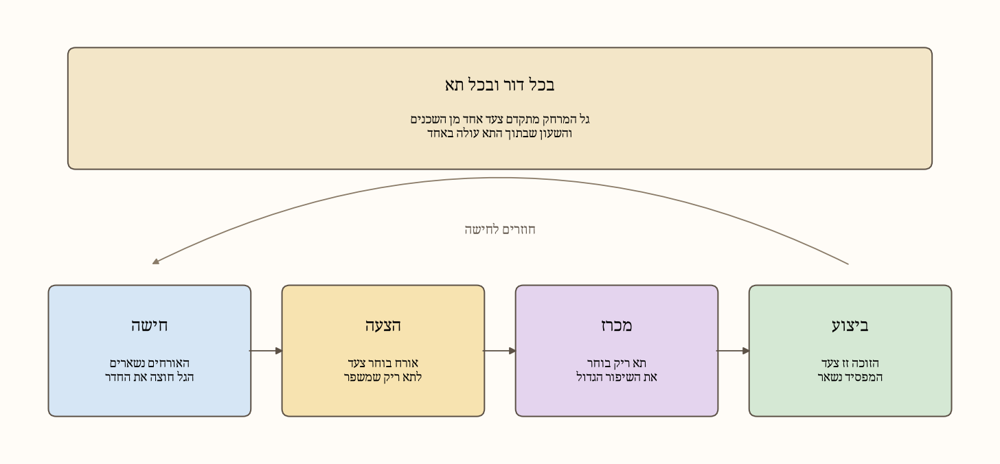

| שעון | שלב | מה נכתב למצב הבא |
| --- | --- | --- |
| 0–29 | חישה | הדייר נשאר. ההצעה והמכרז נמחקים. רק הגל רץ |
| 30 | הצעה | אורח בוחן את עצמו וכל שכן ריק, וכותב כיוון |
| 31 | מכרז | תא ריק קורא את ההצעות של שכניו וכותב מזהה אחד |
| 32 | ביצוע | מי שזכה במכרז זז צעד. מי שהפסיד נשאר |

אורך ההמתנה הוא `GRID_SIZE` = 30. קוטר הלוח בצ'בישב הוא 29. גל נכון חוצה את החדר ב־29 דורות. צל של מיקום ישן (ערך 0 שנשאר אחרי שהאורח זז) לא יכול להחזיק את עצמו: בכל דור המינימום מחוץ למקור עולה לפחות באחד, כי אין תא שמייצר 0 מלבד המקור עצמו. אחרי 30 עדכונים הצל הגיע לתקרה והגל הנכון כבר מילא את הלוח. המוניטור בודק את זה לפני כל שלב הצעה ומשווה את השדה למרחק צ'בישב אמיתי. בריצות של 2000 דורות הבדיקה עברה בכל מחזור, גם אחרי תזוזות.

### לחץ אישי, לא הלחץ הגלובלי

בשלב ההצעה אורח i על תא מועמד (התא שלו או שכן ריק) מחשב

<span dir="ltr">sᵢ = Σ (k ≠ i) |dist(k) − Mᵢₖ|</span>

`dist` נקרא מווקטור המרחק **של התא המועמד**. כשהשדה מדויק, זה בדיוק מרחק צ'בישב מן המועמד אל כל ישות. האורח בוחר את המועמד עם sᵢ הקטן ביותר. אם אין שיפור ממש הוא נשאר. שוויון נשבר כך: להישאר עדיף על לזוז, צעד ישר עדיף על אלכסון, ואחר כך קוד הכיוון הקטן. בלי זה מרחק צ'בישב, שיש לו כמה שכנים באותו מרחק, היה דוחף את כולם לאותו כיוון.

זה לא מדד האיכות של סעיף 6. כאן נכנסת רק השורה של האורח עצמו, ורק המרחקים שהוא רואה בשדה. המדד הגלובלי סוכם את כל השורות ומחושב במוניטור ממיקומים אמיתיים. הכלל לא קורא לו.

### למה שלושה דורות בשביל צעד אחד

אם שני אורחים יחליטו באותו דור להיכנס לאותו תא, אף אחד מהם לא רואה את השני: הם במרחק 2, מחוץ לשכנות. לכן ההכרעה לא נעשית אצל האורח אלא אצל תא היעד, בשלב נפרד:

1. **הצעה.** האורח כותב כיוון ושיפור על התא שלו. הוא עדיין לא זז.
2. **מכרז.** תא ריק מסתכל על שמונת שכניו. שכן שכיוונו פונה אליו הוא מועמד. נבחר השיפור הגדול ביותר, ובשוויון המזהה הקטן. התא כותב את המזהה.
3. **ביצוע.** אורח מתפנה רק אם תא היעד ריק **ובמכרז שלו כתוב המזהה של האורח**. תא ריק מתמלא רק אם המכרז שלו מצביע על שכן שבאמת מכוון אליו. שני הצדדים קוראים את אותו מצב קודם, ולכן אין שכפול ואין מחיקה.

השולחן אף פעם לא זז: הכלל אומר "אם אתה השולחן, הישאר השולחן", ואורח מציע רק תא ריק.

### פסאודוקוד

```
לכל תא, סינכרונית, מתוך המצב הנוכחי בלבד:

  לכל ישות k:
    אם occupant = הישות k:
      dist'[k] ← 0
    אחרת:
      dist'[k] ← min(MAX_DIST, 1 + min { dist[k] של שכן })
  clock' ← (clock + 1) mod CYCLE

  אם clock בשלב חישה:
    occupant' ← occupant
    proposal' ← להישאר
    bid' ← אין

  אם clock בשלב הצעה:
    occupant' ← occupant
    אם התא הוא אורח:
      בין התא לבין שכנים ריקים, בחר את הלחץ האישי הקטן ביותר
      אם יש שיפור: proposal' ← הכיוון, gain' ← השיפור
      אחרת: proposal' ← להישאר

  אם clock בשלב מכרז:
    proposal' ← proposal          # ההצעה נשארת כדי שהשכן יקרא אותה
    אם התא ריק:
      bid' ← המציע השכן עם gain הגדול ביותר
              (שוויון: המזהה הקטן)

  אם clock בשלב ביצוע:
    proposal' ← להישאר
    bid' ← אין
    אם התא שולחן: occupant' ← שולחן
    אם התא אורח והיעד הריק בחר בו: occupant' ← ריק
    אם התא ריק והמכרז מצביע על שכן שמכוון לכאן: occupant' ← האורח
    אחרת: occupant' ← occupant
```

העדכון כולו נכתב ללוח חדש. הפונקציה `transition` ב־`ca_rules.py` לא משנה את הקלט.

---

## 4. טבלת קבועים

הקבועים של המודל יושבים ב־`constants.py`. קבועי ציור (גודל דמות, צבעים) יושבים בראש `viz.py` ואינם נכנסים לכלל.

| קבוע | ערך | למה |
| --- | --- | --- |
| `GRID_SIZE` | 30 | צלע הלוח. הדרישה היא לפחות 30 |
| `TABLE_ROW`, `TABLE_COL` | 15, 15 | השולחן קבוע במרכז, `GRID_SIZE // 2` |
| `EMPTY` … `TABLE` | 0 … 6 | זהות הדייר בתא |
| `NUM_GUESTS` | 5 | A–E |
| `ENTITY_COUNT` | 6 | אורחים ועוד השולחן |
| `MAX_DIST` | 29 | מרחק צ'בישב מפינה לפינה הנגדית |
| `DISTANCE_STEP` | 1 | כמה עולה המרחק כשעוברים לשכן |
| `MAX_GAIN` | 145 | חסם על שיפור הלחץ האישי, 5×29 |
| `NEIGHBORHOOD_RADIUS` | 1 | רדיוס מור |
| `STAY` … `NORTHWEST` | 0 … 8 | קוד כיוון |
| `STEP_LENGTH` | 0, 1 או 2 | אורך מנהטן של הצעד. שובר שוויון: ישר לפני אלכסון |
| `SENSE_PHASES` | 30 | דורות שבהם רק הגל רץ |
| `PROPOSE_CLOCK` | 30 | שעון של שלב ההצעה |
| `BID_CLOCK` | 31 | שעון של שלב המכרז |
| `COMMIT_CLOCK` | 32 | שעון של שלב הביצוע |
| `CYCLE_LENGTH` | 33 | אורך מחזור מלא |
| `INITIAL_CLOCK` | 0 | כל התאים מתחילים בחישה |
| `NO_BID` | 0 | תא שלא בחר אורח |
| `DEFAULT_GENERATIONS` | 2000 | אורך הריצה שנדרש |
| `SNAPSHOT_EVERY` | 100 | כל כמה דורות נשמרת תמונה |
| `DEFAULT_SEEDS` | 0, 1, 2, 3, 4 | חמישה תנאי התחלה |
| `FIELD_DEMO_GENERATIONS` | 0, 1, 2, 5, 10, 20, 29 | דורות שמראים את גל המרחק |
| `CELLS_TOUCHED_BY_ONE_MOVE` | 2 | תא שמתפנה ותא שמתמלא |
| `TAIL_CYCLES` | 10 | חלון לסיכום התנודתיות בסוף הריצה |

---

## 5. מהלך הסימולציה

דור 0: השולחן ב־(15, 15), חמשת האורחים בתאים אקראיים שונים, לפי הזרע. שדה המרחק הוא 0 רק על התא של כל ישות, ו־29 בכל מקום אחר. את הגל האוטומט בונה בעצמו.

כך נראה הגל של השולחן בזרע 0, לפני שמישהו זז. בדור 0 רק תא השולחן הוא 0. בכל דור הריבוע גדל בצעד אחד. בדור 29, קוטר הלוח, השדה מלא. הריבועים הם קווי הגובה של מרחק צ'בישב.

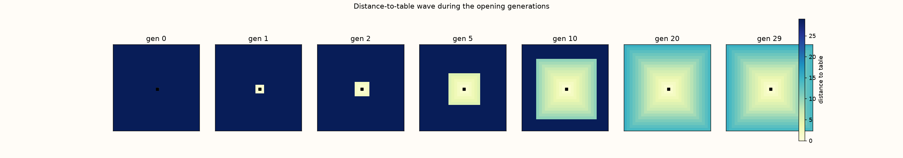

תמונת מצב נשמרת בדור 0 ובכל 100 דורות עד 2000, תחת `output/example/seed_0/` ו־`output/interesting/seed_0/`. כאן מבחר מן הדוגמה, זרע 0. הלחץ יורד מ־165 ל־45 כבר סביב דור 400, ואחר כך התמונה לא זזה: זה מינימום מקומי, לא תקיעה של הכלל.

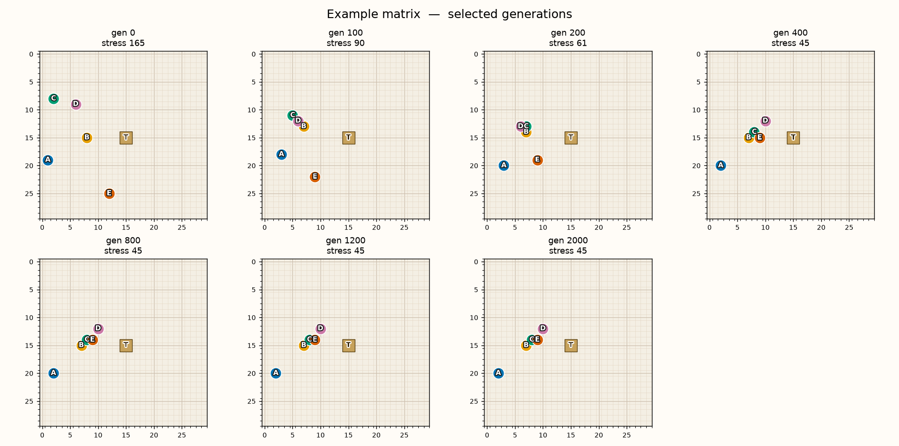

הקבצים הבודדים, למשל `output/example/seed_0/gen_0000.png` עד `gen_2000.png`, הם אותה סדרה בצעד של 100. אנימציה של רגעי התזוזה נמצאת ב־`output/example/animation_seed0.gif`. חלון חי: `python3 gui.py --matrix example --seed 0`.

---

## 6. איכות הסידור

### איך מודדים

המדד מחושב רק ב־`measure_stress` שב־`simulation.py`, מתוך מיקומי האורחים והשולחן על הלוח. הוא לא נקרא מ־`ca_rules.py`.

נסמן ב־d(i,k) את מרחק צ'בישב האמיתי בין אורח i לישות k. המטריצה M היא בת 5 שורות ו־6 עמודות, בלי שורה לשולחן כי לשולחן אין העדפות. העמודות הן A B C D E T.

<span dir="ltr">Q = Σᵢ Σ (k ≠ i) |d(i, k) − Mᵢₖ|</span>

יש 25 מחוברים: כל אורח מול ארבעה אורחים אחרים ומול השולחן. זוג לא סימטרי נספר פעמיים, פעם מכל צד, כי M_AB ו־M_BA הם רצונות שונים. Q קטן יותר הוא סידור טוב יותר. מרחק 0 בין שני דיירים שונים בלתי אפשרי, לכן כל תא 0 מחוץ לאלכסון תורם לפחות 1 לחסם תחתון.

המטריקה זהה לזו שהגל מודד. כשאורח מוריד את הלחץ האישי שלו, הוא מוריד בדיוק את השורה שלו בתוך Q. השורות של האחרים יכולות לעלות, כי כולם זזים באותו דור וכל אחד רואה רק את עצמו. לכן Q לא חייב לרדת בכל צעד. השאלה היא אם לאורך הריצה הוא יורד בצורה ברורה.

### מטריצת הדוגמה

חמישה זרעים, 2000 דורות:

| זרע | Q בהתחלה | Q בסוף | ירידה | מינימום | תזוזות | צעדים שירדו / עלו / קפאו |
| --- | ---: | ---: | ---: | ---: | ---: | --- |
| 0 | 165 | 45 | 72.7% | 42 | 40 | 10 / 1 / 49 |
| 1 | 243 | 38 | 84.4% | 38 | 118 | 22 / 10 / 28 |
| 2 | 304 | 52 | 82.9% | 52 | 67 | 17 / 0 / 43 |
| 3 | 223 | 39 | 82.5% | 39 | 51 | 12 / 0 / 48 |
| 4 | 181 | 48 | 73.5% | 48 | 39 | 9 / 0 / 51 |
| ממוצע | 223.2 | 44.4 | 80.1% |  |  |  |

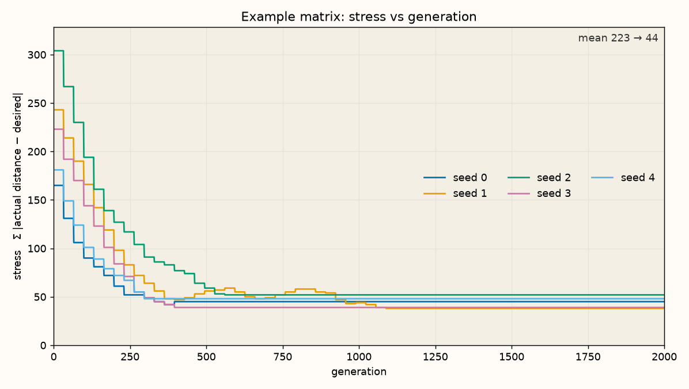

המדרגות הן מחזורי ההמתנה: במשך 30 דורות אף אחד לא זז, ובדור הביצוע הלחץ קופץ. אחרי כמה מאות דורות כל הזרעים מתייצבים. הממוצע יורד מ־223 ל־44, בערך פי חמישה. הסטייה הממוצעת לזוג יורדת מכ־8.9 לכ־1.8.

השיפור לא תלוי בזרע מוצלח. כל חמשת תנאי ההתחלה יורדים ביותר מ־70%, וכולם נעצרים בפס צר, בין 38 ל־52. מה שכן תלוי בזרע הוא **הסידור עצמו** והדרך אליו. זרע 1 ממשיך לזוז אחרי דור 500 ויש לו עשרה צעדים שבהם Q עולה לרגע, ובכל זאת הוא מסיים הכי נמוך. זרע 0 נעצר כבר סביב דור 400.

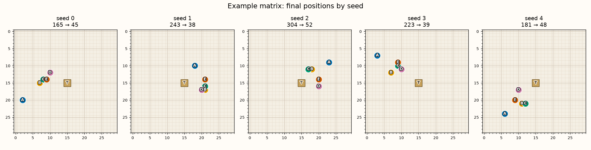

בזרע 0 נשארת שגיאה בולטת אחת. A רוצה מרחק 0 מן השולחן, ובפועל הוא במרחק 13. שאר השורה שלו כמעט מדויקת: מרחק 5 מ־B כמו שביקש, 7 מ־E כמו שביקש. B, C, D, E יושבים צמוד זה לזה ליד השולחן, כי הרבה מן הרצונות ביניהם הם 0 או 1. אם A ייכנס לתוך החבורה הוא יתקרב לשולחן, אבל יקלקל את המרחקים הגדולים שהוא ביקש מ־C ומ־D. זה מינימום מקומי של השורה שלו, לא כשל של הגל.

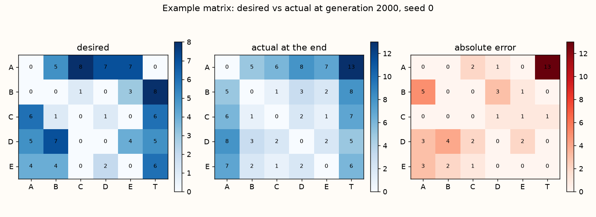

הלחץ האישי של כל אורח, עדיין לפי מרחקים אמיתיים, יורד יחד עם הסכום. A נשאר קצת מעל האחרים בגלל השולחן. הסכום המקווקו הוא Q.

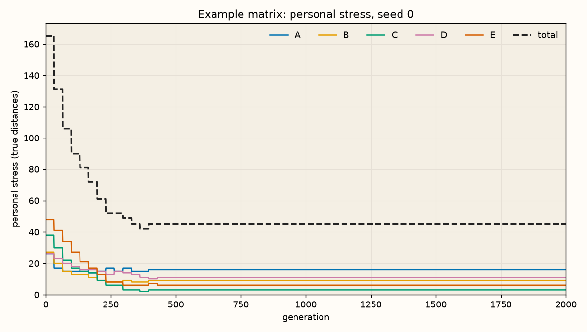

חסם תחתון גס: במטריצה יש שישה תאי 0 בין ישויות שונות (A אל השולחן, B אל A, B אל D, C אל E, D אל C, E אל C). כל אחד מהם שווה לפחות 1, כי שני דיירים לא חולקים תא. מעבר לזה המטריצה לא סימטרית ולא מקיימת אי־שוויון משולש, אז אין שיכון בלי שגיאה. 38–52 על 25 זוגות הוא שיכון סביר של טבלה סתירתית, לא עצירה אקראית.

---

## 7. מטריצה עם התנהגות מעניינת

המטריצה השנייה מרכיבה שלוש אישיויות מן המאמר באותו חדר.

| | A | B | C | D | E | T |
| --- | ---: | ---: | ---: | ---: | ---: | ---: |
| A | 0 | 1 | 9 | 8 | 8 | 4 |
| B | 16 | 0 | 9 | 10 | 10 | 14 |
| C | 14 | 14 | 0 | 14 | 14 | 14 |
| D | 8 | 8 | 12 | 0 | 1 | 1 |
| E | 8 | 8 | 12 | 1 | 0 | 1 |

- **A רודף אחרי B.** A רוצה מרחק 1. B רוצה מרחק 16, כמעט קוטר החדר, וגם מרחק 14 מן השולחן, כלומר אל השפה.
- **C בודד.** 14 מכולם ומן השולחן. הפינות הן המקום היחיד שקרוב לזה.
- **D ו־E חבורה על השולחן.** מרחק 1 זה מזה ומרחק 1 מן השולחן, ורחוקים מן הבודד.

אי אפשר לרצות את A ואת B יחד: אותם שני תאים לא יכולים להיות גם במרחק 1 וגם במרחק 16.

המסלולים בזרע 0 מראים את שלוש האישיויות בבת אחת. העיגול החלול הוא ההתחלה, המלא הוא הסוף.

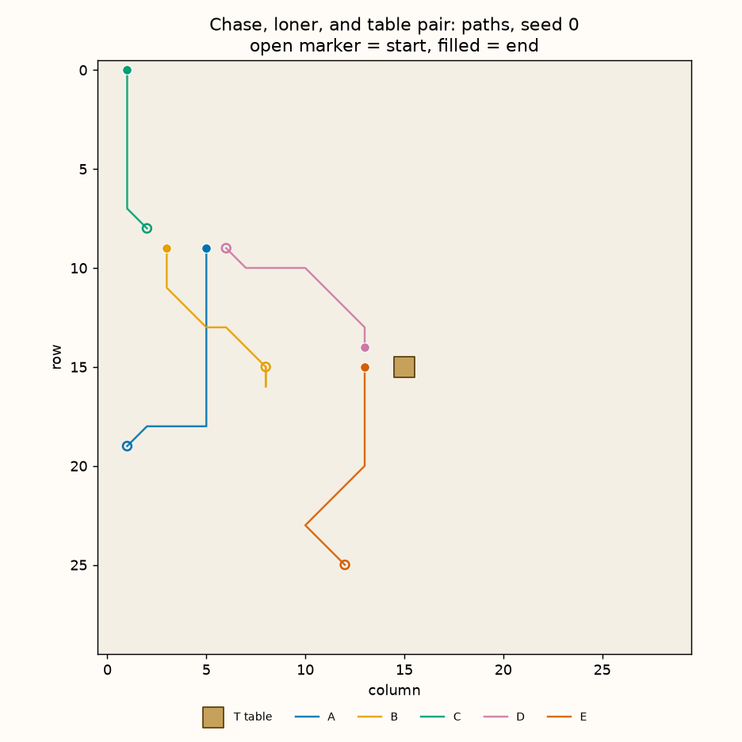

C עולה לפינה (0, 0) ונשאר שם. D ו־E נמשכים אל השולחן ונעצרים צמודים זה לזה, במרחק 2 מן השולחן (מרחק 1 משולחן וגם 1 זה מזה אפשרי גיאומטרית, אבל אצלם נשארה סטייה של 1: מינימום מקומי צמוד ליעד). A ו־B נעים זה לקראת זה בצד שמאל של החדר ונעצרים במרחק 2. A כמעט קיבל את מה שביקש. B לא: הוא רצה 16 ונשאר ב־2, כי בריחה הייתה מקלקלת מרחקים אחרים שכבר ישבו על היעד (אל C, D, E). הלחץ האישי של B נשאר הגבוה בחדר, בערך 16 מתוך Q=46, בעוד A, D ו־E יורדים אל מתחת ל־8.

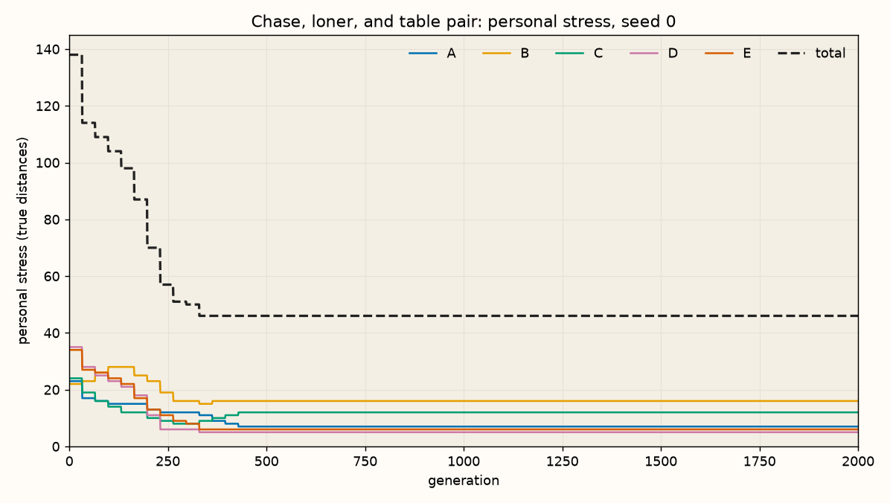

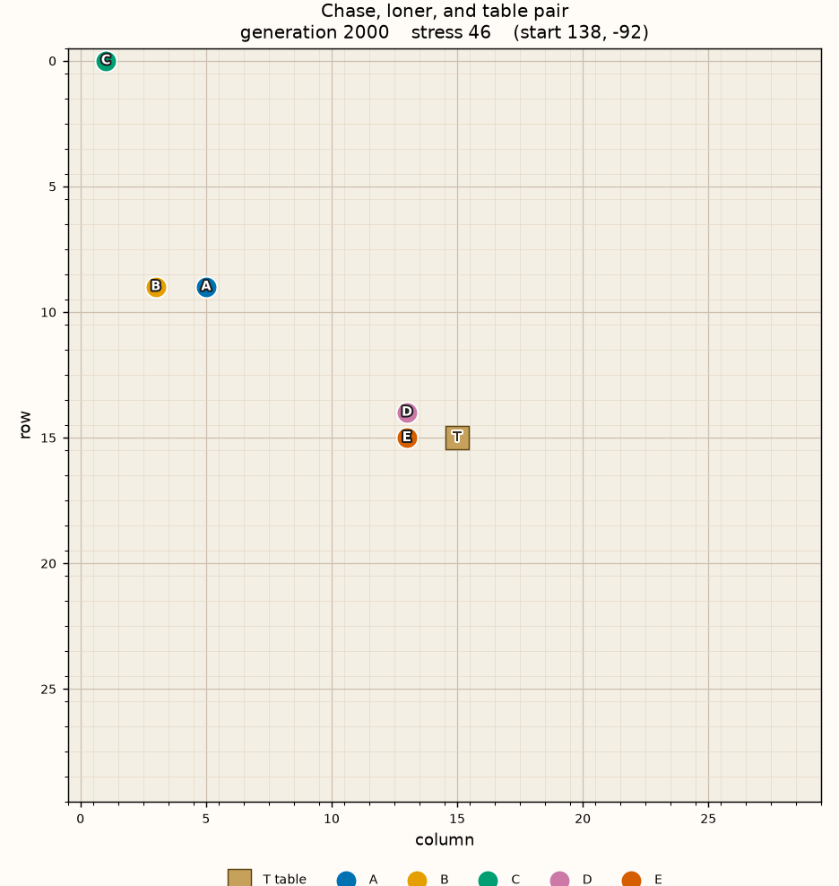

חמשת הזרעים מבהירים מה יציב ומה תלוי בהתחלה.

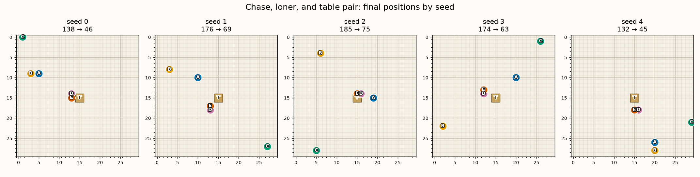

| זרע | Q בהתחלה | Q בסוף | ירידה | מה קרה ל־A ול־B |
| --- | ---: | ---: | ---: | --- |
| 0 | 138 | 46 | 66.7% | A תפס את B (מרחק 2) |
| 1 | 176 | 69 | 60.8% | B ברח שמאלה, A נשאר באמצע |
| 2 | 185 | 75 | 59.5% | B למעלה, A ליד השולחן, לא נפגשו |
| 3 | 174 | 63 | 63.8% | B הגיע לפינה התחתונה, A לא השיג אותו |
| 4 | 132 | 45 | 65.9% | A תפס את B למטה מימין |
| ממוצע | 161.0 | 59.6 | 63.0% |  |

בכל הזרעים C מסיים ליד פינה או על השפה, ו־D עם E מסיימים ליד השולחן. זה נובע ישר מן השורות שלהם, כמעט בלי קשר לשאר. גורל המרדף תלוי בהתחלה: לפעמים A מספיק להיצמד לפני ש־B ננעל על מרחקים אחרים, ולפעמים B מגיע לשפה והמרדף נעצר במרחק גדול. בשני המקרים Q יורד בכ־60% ואז קופא. אין כאן מחזור אינסופי. החדר חסום, וברגע שאין צעד שכן שמשפר את השורה של אף אחד, כולם נשארים. זה בדיוק מצב יציב מן הסוג שהמאמר מתאר, והוא נובע מן הסתירה בין השורה של A לשורה של B ולא מכשל של הגל.

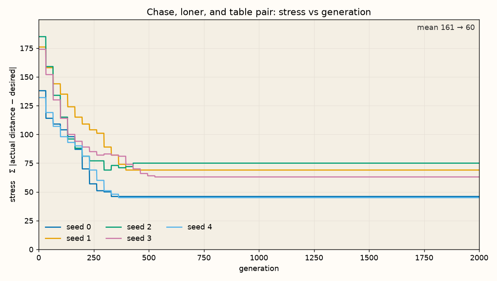

---

## סיכום

האוטומט סופי, אחיד, ומקומי: מור ברדיוס 1, אותו כלל לכל תא, והמצב הבא נקבע רק מן השכונה. מרחק לא נמדד גלובלית אלא רץ כגל, והאורחים זזים רק אחרי שהגל מדויק. קונפליקט על תא נפתר במכרז מקומי של התא הריק.

על מטריצת הדוגמה הלחץ הממוצע יורד מ־223.2 ל־44.4 בכל חמשת הזרעים. הסידור הסופי תלוי בהתחלה, כיוון הירידה לא. על המטריצה השנייה אותם כללים מייצרים בודד בפינה, זוג על השולחן, ומרדף שאפשר לראות במסלולים: לפעמים הרודף תופס, לפעמים הנרדף מגיע לשפה. שתי ההתנהגויות נובעות מן השורות של המטריצה.
